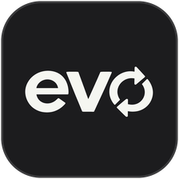
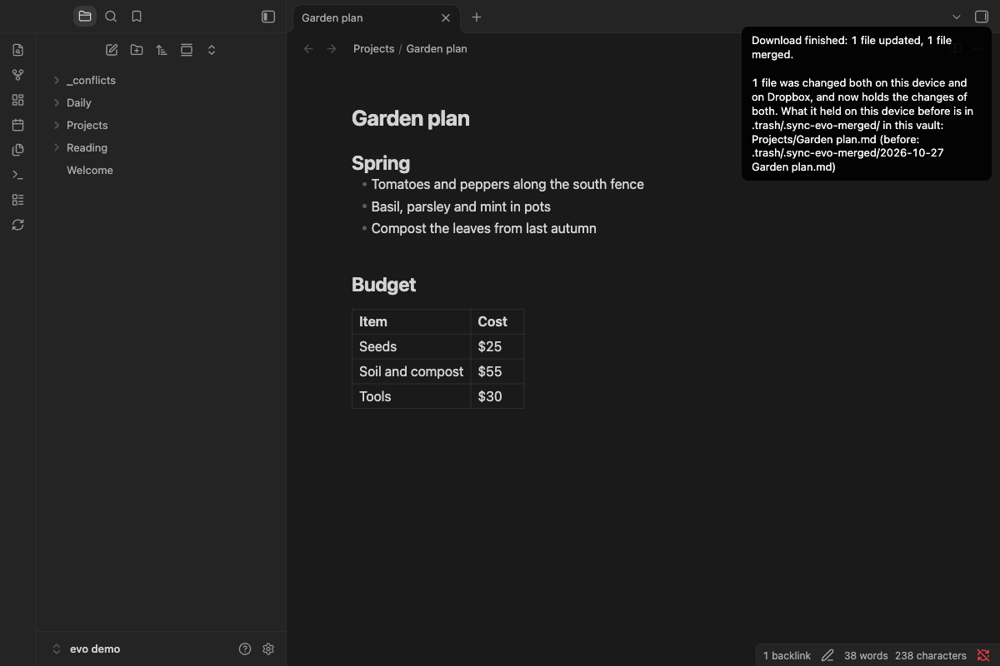

# Sync Evo

  

[English](https://github.com/seking/obsidian-sync-evo/blob/main/README.md)

保管庫を、すべてのデバイスで同期します。使うのは、自分の GitHub・Dropbox・Google Drive のどれかです。

> [!NOTE]
> **有料化を始めた後は、有料の部分があります。** 今は、Sync Evo のすべてが無料です。Dropbox と Google Drive での同期は、いずれ有料になる可能性があり、その時はライセンスキーが要ります。キーは月 $3・年 $24・買い切り $49 で、1つのキーで両方を使えます。どのサービスでも、有料化は、この README とリリースノートで知らせてから始めます。始めた後も、Dropbox と Google Drive は、始めた日（それより後に使い始めた人は、使い始めた日）から3か月は無料です。[料金](https://github.com/seking/obsidian-sync-evo/blob/main/README.ja.md#料金)

スマートフォンでもパソコンでも動きます。Git のインストールは要りません。

## Sync Evo の特長

**自分のストレージを使います。** ノートは、自分の GitHub のリポジトリ・Dropbox・Google Drive のどれかに保存されます。開発者にアカウントを作る必要は無く、間にサーバーもありません。

**スマートフォンと大きな保管庫のために作りました。** 数千ファイルの最初のダウンロードは、途中で止まっても、続きから進みます。

**ノートを上書きしません。** 2台のデバイスで変えたノートは、統合するか、両方を残します。多くのファイルを削除する前には、確認します。

**GitHub に履歴が残ります。** アップロードのたびにコミットになります。ノートの前のバージョンは、リポジトリの履歴に残ります。

**同期する物を選べます。** フォルダ（全デバイス、またはこのデバイスだけ）、このデバイスのファイルの種類、保管庫の設定の一部を、除外できます。

**自動同期は、邪魔をしません。** 有効にすると、起動時と一定の間隔で同期します。問題が無い時は、何も知らせません。

## ノートを失わないしくみ

- 2台のデバイスで変えたノートは、統合するか、両方を残します。デバイスの方は `_conflicts/` に残ります。統合する前の内容は `.trash/` に残します。
- 多くのファイルを削除する前、デバイスで最初に、すでにファイルがある所か、公開の GitHub リポジトリへアップロードする前、最初のダウンロードで内容の違うファイルが見つかった時、GitHub の履歴が書き換えられた時は、止まって確認します。
- このデバイスが最後にダウンロードした後にサービスで変わったファイルを、アップロードで上書きしません。Google Drive ではまれに上書きし得ますが、もう一方の内容は Google Drive のファイルのバージョン履歴に残ります。
- 途中で止まったダウンロードは、続きから進みます。GitHub と Google Drive へのアップロードも同じです。

[同期のしくみ](https://github.com/seking/obsidian-sync-evo/blob/main/docs/ja/syncing.md)

## GitHub・Dropbox・Google Drive のどれか

- **GitHub のアカウントがある**：GitHub を。
- **無い**：保管庫が 2 GB までなら Dropbox を。2台のデバイスで変えたノートを統合できます。超えるなら Google Drive を。どちらかをもう使っているなら、それでも構いません。

Dropbox と Google Drive は、ログインするだけで使えます。リポジトリやトークンは要りません。

[3つの比較](https://github.com/seking/obsidian-sync-evo/blob/main/docs/ja/choosing-a-service.md)

## 料金

- **GitHub**：今は無料です。
- **Dropbox と Google Drive**：今は無料です。いずれ有料になる可能性があり、その時は3か月の無料の後に、ライセンスキーが要ります。1つのキーで両方を使えます。キーは月 $3・年 $24・買い切り $49 で、Dodo Payments で販売します。決済と税の手続きは Dodo Payments が行います。
- **まだ始めていません。** どのサービスでも、有料化は、この README とリリースノートで知らせてから、後の版の Sync Evo で始めます。

始めた後のしくみ：

- 3か月は、Dropbox や Google のアカウントごとに、有料化を始めた日か、そのアカウントで最初に同期した日の遅い方から数えます。有料化を始めた日より前から数えることはありません。
- その3か月が終わった後や終わる間際に、デバイスで有料化の入った Sync Evo を初めて動かした時も、そのデバイスでは、その日から14日は無料です。終わる前に知らせるためです。
- 無料の期間が終わる14日前と7日前を過ぎた後の、最初の同期の時に知らせます。
- 終わった後の30日は、ダウンロードだけを行い、何もアップロードしません。その後は、Dropbox や Google Drive との同期を止めます。デバイスでも、Dropbox や Google Drive でも、何も消しません。
- キーは、Sync Evo の設定に、デバイスごとに入れます。キーは Dodo Payments に問い合わせて確かめます。Dodo Payments に届かない時は、使えていたキーは14日のあいだ使えます。

返金などは[利用規約](https://gyap.jp/sync-evo/terms)にあります。

## 始め方

### インストール

Sync Evo は、コミュニティプラグインの一覧にあります。

1. 設定 → コミュニティプラグインで、**制限モード**がオンならオフにします。
2. **閲覧**を押し、**Sync Evo**を検索して、インストールし、有効にします。[一覧のページ](https://community.obsidian.md/plugins/sync-evo)を開いて **Add to Obsidian** を押し、開いた Obsidian でインストールして有効にしても入れられます。

前に BRAT で入れた時は、そのまま使えます。BRAT のベータプラグインの一覧から Sync Evo を外すと、更新は Obsidian だけが行います。外してもファイルと設定は消えません。

### GitHub

1. 保管庫のリポジトリが無ければ、GitHub で[空のプライベートリポジトリを作ります](https://github.com/new)。[GitHub のアカウント](https://github.com/signup)が無ければ、先に作ります。無料です。
2. [トークンを作り](https://github.com/settings/personal-access-tokens/new?name=Sync+Evo&description=Obsidian+Sync+Evo&expires_in=90&contents=write)、そのページで保管庫のリポジトリを選びます。
3. 設定 → コミュニティプラグイン → Sync Evo で、**リポジトリ**と**ブランチ**を入力し、**トークン**をシークレットとして保存します。
4. **テスト**を押します。次に同期します。画面の端に並ぶアイコンの列（リボン）から、円を描く2本の矢印のアイコン（**同期する**）をタップするか、コマンドパレットで**Sync Evo: 同期する**を実行します。

### Dropbox

今は無料です。いずれ、3か月の無料の後にライセンスキーが要るようになる可能性があります。[料金](https://github.com/seking/obsidian-sync-evo/blob/main/README.ja.md#料金)

1. Dropbox のアカウントが無ければ、[作ります](https://www.dropbox.com/register)。無料です。
2. 設定 → コミュニティプラグイン → Sync Evo で、**サービス**を**Dropbox**にします。
3. **接続する**を押し、ブラウザで Sync Evo を許可します。
4. **テスト**を押し、GitHub の手順 4 と同じように同期します。

### Google Drive

今は無料です。いずれ、3か月の無料の後にライセンスキーが要るようになる可能性があります。[料金](https://github.com/seking/obsidian-sync-evo/blob/main/README.ja.md#料金)

1. 設定 → コミュニティプラグイン → Sync Evo で、**サービス**を**Google Drive**にします。
2. **接続する**を押します。コードが表示され、コピーされます。
3. **ブラウザで開く**を押します。ブラウザで `google.com/device` が開き、コードもまたコピーされます。
4. コードを貼り、Google アカウントを選んで、Sync Evo を許可します。終わったら Obsidian に戻ります。設定画面に、接続したアカウントが出ます。
5. **テスト**を押し、GitHub の手順 4 と同じように同期します。

Sync Evo から見えるのは、Google Drive の中の Sync Evo が作ったファイルだけです。[詳細](https://github.com/seking/obsidian-sync-evo/blob/main/docs/ja/google-drive.md)

[手順の詳しい説明](https://github.com/seking/obsidian-sync-evo/blob/main/docs/ja/setup.md)

## 知っておくこと

- Git で同期している保管庫は、1台のデバイスでは Git か Sync Evo のどちらかだけを使ってください。パソコンは Git、スマートフォンは Sync Evo のように、1つのリポジトリを分けて使えます。[Git から移る手順](https://github.com/seking/obsidian-sync-evo/blob/main/docs/ja/faq.md#デバイスを-git-から-sync-evo-に移す)
- iCloud Drive の保管庫も使えますが、対応は試験的です。[詳細](https://github.com/seking/obsidian-sync-evo/blob/main/docs/ja/icloud.md)
- 「インストールされているコミュニティプラグイン」を同期すると、ほかのデバイスから来たプラグインのコードが動きます。[詳細](https://github.com/seking/obsidian-sync-evo/blob/main/docs/ja/settings.md#インストールされているコミュニティプラグイン)
- 「アクティブなコミュニティプラグインのリスト」を同期するなら、全デバイスで Sync Evo を有効にしておいてください。[理由](https://github.com/seking/obsidian-sync-evo/blob/main/docs/ja/settings.md#アクティブなコミュニティプラグインのリスト)
- Sync Evo を前のバージョンに戻す時は、そのデバイスで同期を最後まで終えてから戻してください。[手順](https://github.com/seking/obsidian-sync-evo/blob/main/docs/ja/faq.md#sync-evo-を前のバージョンに戻すには)

## 通信とプライバシー

Sync Evo が接続するのは、GitHub（`api.github.com`、`codeload.github.com`）、Dropbox（`api.dropboxapi.com`、`content.dropboxapi.com`、`www.dropbox.com`）、Google（`oauth2.googleapis.com`、`www.googleapis.com`）だけです。Google Drive に接続する時は、ブラウザで `google.com/device` を開きます。どれも保管庫の同期に使い、通信するのは、同期する時、自動同期を有効にしている時、接続する時だけです。有料化を始めた後は、Dropbox と Google Drive で、入れたライセンスキーを確かめるために Dodo Payments（`live.dodopayments.com`）にも接続します。送るのはキーとデバイス名で、保管庫の物は送りません。ほかへは何も送りません。利用状況は集めず、開発者のサーバーもありません。GitHub・Dropbox・Google のどれかのアカウントが必要です。[詳細](https://github.com/seking/obsidian-sync-evo/blob/main/docs/ja/network.md)、[プライバシーポリシー](https://gyap.jp/sync-evo/privacy)

## 詳しく知る

- [セットアップの手順](https://github.com/seking/obsidian-sync-evo/blob/main/docs/ja/setup.md)
- [GitHub・Dropbox・Google Drive のどれか](https://github.com/seking/obsidian-sync-evo/blob/main/docs/ja/choosing-a-service.md)
- [Sync Evo とほかの同期の手段](https://github.com/seking/obsidian-sync-evo/blob/main/docs/ja/compared.md)
- [同期のしくみ](https://github.com/seking/obsidian-sync-evo/blob/main/docs/ja/syncing.md)と[コマンド](https://github.com/seking/obsidian-sync-evo/blob/main/docs/ja/syncing.md#コマンド)
- [設定](https://github.com/seking/obsidian-sync-evo/blob/main/docs/ja/settings.md)
- [Dropbox](https://github.com/seking/obsidian-sync-evo/blob/main/docs/ja/dropbox.md)
- [Google Drive](https://github.com/seking/obsidian-sync-evo/blob/main/docs/ja/google-drive.md)
- [iCloud Drive の保管庫](https://github.com/seking/obsidian-sync-evo/blob/main/docs/ja/icloud.md)
- [制限、未対応のこと、試験した環境](https://github.com/seking/obsidian-sync-evo/blob/main/docs/ja/limits.md)
- [通信とプライバシー](https://github.com/seking/obsidian-sync-evo/blob/main/docs/ja/network.md)
- [よくある質問](https://github.com/seking/obsidian-sync-evo/blob/main/docs/ja/faq.md)
- [ドキュメントの一覧](https://github.com/seking/obsidian-sync-evo/blob/main/docs/ja/README.md)

## ヘルプ

[よくある質問](https://github.com/seking/obsidian-sync-evo/blob/main/docs/ja/faq.md)を見るか、[issue](https://github.com/seking/obsidian-sync-evo/issues) を開いてください。GitHub のアカウントが無い時は、contact@gyap.jp にメールをください。報告には、トークンや人に見せたくないファイル名を書かないでください。セキュリティの問題は、公開せずに報告してください。方法は [SECURITY.md](https://github.com/seking/obsidian-sync-evo/blob/main/SECURITY.md) にあります。

## ライセンス

Copyright (C) 2026 seking. Sync Evo は2つの部分に分かれ、ライセンスが違います。どちらも無保証です。

- **同期の本体と GitHub**: オープンソースです。[AGPL-3.0-only](https://github.com/seking/obsidian-sync-evo/blob/main/LICENSE-AGPL) のもとで配布します。
- **Dropbox と Google Drive**（`pro/` のフォルダ。ライセンスキーの照合を含む）: ソースは公開していますが、オープンソースではありません。[Elastic License 2.0](https://github.com/seking/obsidian-sync-evo/blob/main/pro/LICENSE) のもとで配布します。使う、変える、配ることはできますが、ライセンスキーの照合を変える・外す・迂回すること、ライセンスや著作権の表示を消すこと、ほかの人にホスティングのサービスとして提供することはできません。

どのファイルがどちらのライセンスかは、[LICENSE](https://github.com/seking/obsidian-sync-evo/blob/main/LICENSE) にあります。

同梱しているライブラリのライセンスは、[このページ](https://github.com/seking/obsidian-sync-evo/blob/main/docs/ja/third-party-licences.md)にあります。

リリースの `main.js` は、このリポジトリから、1つだけ足してビルドしています。Sync Evo の Google のクライアントのシークレットです。Google の OAuth 2.0 のポリシーが、公開のリポジトリに置かないよう求めているためです。そのため、ビルドの結果がリリースと同じかを確かめる Obsidian の検査では、1行だけ違いが出ます。シークレットを入れてビルドすれば、`main.js` はリリースとバイト単位で一致します。

Sync Evo をビルドする時や、開発に協力する時は、[CONTRIBUTING.md](https://github.com/seking/obsidian-sync-evo/blob/main/CONTRIBUTING.md) を見てください。
